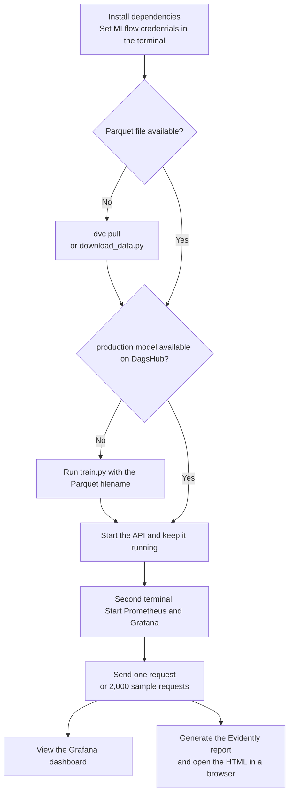

# Implementation: Green Taxi MLOps

Random Forest for predicting trip duration in minutes. Inputs: `PULocationID`, `DOLocationID`, `trip_distance`. The project replays completed historical trips; the actual distance is only known after the trip.

## Structure

| Component | Purpose |
| --- | --- |
| `download_data.py` / `prepare_data.py` | Download Parquet files; keep durations of 1–60 minutes and distances of 0.1–100 miles |
| `train.py` | Train on the selected file with an 80/20 split; log RMSE and the model to MLflow |
| `api.py` / `pipeline.py` | FastAPI; load the model from DagsHub and serve predictions |
| `prediction_logging.py` | Log successful requests with inputs, predictions, and UTC timestamps |
| `send_sample_requests.py` | Send 2,000 randomly selected January trips through the API |
| `generate_drift_report.py` | Compare the latest 2,000 requests with cleaned January reference data |
| GitHub / GitHub Actions | Version code and `.dvc` references; automatically run January training |
| Google Drive / DVC | Store and version the actual training data |
| DagsHub / MLflow | Store parameters, tags, RMSE, models, versions, and the `production` alias |
| Docker / Prometheus / Grafana | Collect API metrics every 5 seconds and display them in dashboards |

Python scripts are in `00_project_implementation/`, data in `data/`, and monitoring configuration and results in `monitoring/`. `solution/` contains the separate Iris example.

## Execution Flow



## Run Locally

Requirements: Python 3.13, `uv`, running Docker Desktop, a DagsHub token, and configured Google Drive access for DVC. Run all commands in PowerShell from the project root.

### 1. Environment and Data

```powershell
uv sync --locked
$env:MLFLOW_TRACKING_URI = "https://dagshub.com/moma0900/mle4-mlops-project.mlflow"
$env:MLFLOW_TRACKING_USERNAME = "moma0900"
$env:MLFLOW_TRACKING_PASSWORD = [System.Net.NetworkCredential]::new("", (Read-Host "DagsHub token" -AsSecureString)).Password
uv run dvc pull
```

The MLflow variables apply to this terminal session. Do not commit tokens or keys to Git. As an alternative to downloading through DVC, this command downloads the four configured TLC files directly:

```powershell
uv run python 00_project_implementation/download_data.py
```

### 2. Train When Needed

```powershell
uv run python 00_project_implementation/train.py green_tripdata_2024-01.parquet
```
or use one of the other parquet files:
- green_tripdata_2024-05.parquet
- green_tripdata_2024-08.parquet
- green_tripdata_2025-01.parquet


The first successful model receives the `production` alias. Later versions replace it only when their RMSE is lower on the same validation data. Training uses the full cleaned monthly dataset, without a 50,000-row limit.

### 3. Start the API and Monitoring

In the terminal with the MLflow variables:

```powershell
uv run uvicorn api:app --app-dir 00_project_implementation --host 0.0.0.0 --port 8000 --reload
```

Keep the API running. `--reload` restarts it when Python changes are saved. Binding to `0.0.0.0` allows access from Docker and, depending on the firewall, the local network.

In a second terminal at the project root:

```powershell
docker compose up -d
uv run python 00_project_implementation/http_example_request.py
```

The example request reads `sample-request.json` from the project root. Additional options in Swagger:

- `POST /predict`: provide location IDs and distance; the response contains trip duration in minutes.
- `POST /train`: for example, `{"load_parquet": "green_tripdata_2024-01.parquet"}`; the file must exist locally under `data/`.

The API loads `production` once at startup. After an alias change, restart the API to use the new version.

### 4. Sample Requests and Evidently Report

```powershell
uv run python 00_project_implementation/send_sample_requests.py
uv run python 00_project_implementation/generate_drift_report.py
Start-Process .\monitoring\reports\input_drift.html
```

Requests are appended to `monitoring/prediction_log.csv`. The report checks pickup location, drop-off location, and distance for the latest 2,000 requests. It is a snapshot and must be regenerated after new requests. Drift indicates changes in input distributions; calculating a current RMSE also requires actual trip durations.

## Services and Automation

| Service | Address |
| --- | --- |
| API / Swagger | http://127.0.0.1:8000/docs |
| API metrics | http://127.0.0.1:8000/metrics |
| Prometheus / Targets | http://localhost:9090/targets |
| Grafana | http://localhost:3000 |
| MLflow | https://dagshub.com/moma0900/mle4-mlops-project.mlflow |

Grafana uses `http://prometheus:9090` as its data source. The dashboard shows request counts, average processing time, and status codes 422/500; set automatic refresh to 5 seconds. Request counters reset whenever the API restarts. Prometheus and Grafana persist their data in Docker volumes. The manually created dashboard currently resides in the Grafana volume; export and import it for a fresh setup. Initial Grafana login: `admin` / `admin`; change the password afterward.

The workflow `.github/workflows/dvc-check.yaml` runs manually or on relevant pushes to `main`. It installs locked dependencies, downloads January 2024 data from Drive through DVC, and trains with MLflow tracking on DagsHub. Required GitHub secrets:

- `GDRIVE_CREDENTIALS_DATA`: service account JSON key with read access to the Drive folder.
- `MLFLOW_TRACKING_PASSWORD`: DagsHub token.

To version updated data, run `uv run dvc add data/FILENAME.parquet`, then `uv run dvc push`; afterward, commit and push the updated `.dvc` file. The workflow currently trains on January 2024 only.

## Open Tasks: Automated Response to Drift

Currently, drift is shown in the Evidently HTML report. No automatic response to drift is connected yet.

1. **Alert on drift detection:** Run the Evidently check periodically, expose its result as a Prometheus metric, and configure a Grafana alert with a notification channel. Tune thresholds using representative request batches before enabling alerts.
2. **Automatic retraining after drift:** Training already runs on relevant GitHub pushes or manual workflow starts. Extend the drift check to trigger GitHub Actions through `workflow_dispatch` when persistent, meaningful drift is detected. Pass the selected dataset as a workflow input and retrieve it through DVC. Suitable new training data must include actual trip durations; prediction logs alone are insufficient.
3. **Automatic model rollout:** The RMSE comparison and conditional update of the MLflow `production` alias are already implemented. Add a deployment step on the API host that restarts the API or safely reloads its model after promotion, then verifies predictions. Keep the previous version available for rollback.
